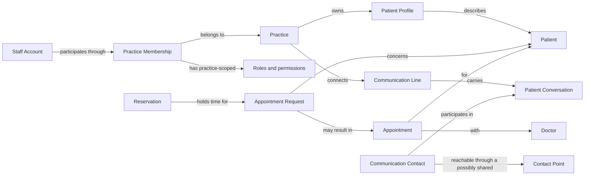

# Medora domain model

This is an evolving, stack-neutral model grounded in the [confirmed product foundation](../.planning/decisions/20261015T085738Z-3/scope-review.md). [GLOSSARY.md](../GLOSSARY.md) holds resolved definitions only. [The active modeling session](../.planning/decisions/20261015T163800Z-5/session.md) holds questions, replies, interpretation and history.

## Established semantic boundaries

- A **Practice** owns its operational records and patient profiles. One **Staff Account** may hold separate **Practice Memberships**, each with its own roles and permissions; roles may combine within a membership.
- The **Patient** receives care. The **Communication Contact** speaks to the practice and may represent another patient. Several contacts may share a **Contact Point**, which alone proves neither identity nor authority. A practice-connected **Communication Line** is distinct from that patient-side address.
- An **Appointment Request** expresses intent; a **Reservation** claims time provisionally; an **Appointment** represents the scheduled consultation. These meanings do not prescribe separate database tables or entity identifiers.
- **Appointment Notification** delivery is distinct from appointment confirmation. A failed message does not silently cancel a confirmed appointment.
- **Patient Profile** and **Intake** preserve the origin of information. An AI summary is not a clinician-verified finding.
- **Staff Conversation** is private by default; **Patient Conversation** involves the contact. **Handoff** changes who actively handles that patient conversation, not who has authority over every practice record.

## Accepted concept relationships

The diagram shows meaning, not storage, cardinality or a finalized aggregate design.

## Resolved first-round scenarios

| Scenario | What it tests | Accepted outcome |
| --- | --- | --- |
| Doctor owns one practice and works at another | Staff identity versus practice membership; multiple roles | One staff identity with independent practice memberships and role combinations |
| Two adults share one WhatsApp number | Contact person versus sender address | Separate Communication Contacts may share a Contact Point; the number does not establish the speaker or representative authority |
| Reservation expires before staff review | Request lifecycle versus temporary hold lifecycle | Keep the underlying request open, explicitly without a reserved slot |

The user's joint reply **"ok, next"** accepts these three recommendations. The [session index](../.planning/decisions/20261015T163800Z-5/session.md) links the original questions, exact reply and separate interpretation. Staff Account and Contact Point are now resolved glossary terms.

When a reservation expires, release its slot, notify the contact and leave the request open needing another slot. Expiry does not close the underlying request or create a confirmed appointment. Explicit withdrawal or closure remains possible; an independent inactivity policy is still undecided.

## Next scenarios — proposals awaiting answers

| Scenario | Question | Recommendation, not yet accepted |
| --- | --- | --- |
| Patient compares two available times | How many active holds can one request have? | Hold one selected slot; other times are suggestions. The confirmed original appointment during rescheduling remains separate. |
| Confirmed consultation moves from Monday to Thursday | Same appointment or unrelated cancellation/new booking? | Preserve appointment continuity and record the approved change. A genuinely cancelled appointment remains cancelled. |
| Receptionist coordinates only one doctor in a multi-doctor practice | Can coverage be narrower than the whole practice? | Explicit doctor coverage within the membership, with an all-doctors option; coverage alone does not grant clinical access. |

## Questions intentionally still open

The next scenarios remain unanswered. Exact verification, fine-grained permissions, shared-patient profile access, independent request inactivity/closure policies, duplicate requests and detailed cross-practice identity relationships still need decisions. The accepted practice-scoped record boundary remains in force. Further lifecycle scenarios must respect staff approval, patient agreement, truthful notifications and the confirmed cancellation/rescheduling rules without choosing storage structures prematurely.

## Relation to existing follow-ups

This session advances the domain-modeling portion of booking-policy and identity/permission work. It does not resolve their numerical settings, verification evidence, fine-grained permissions or complete acceptance matrices. No application code exists to contradict or validate the model; there is only repository tooling and documentation.
