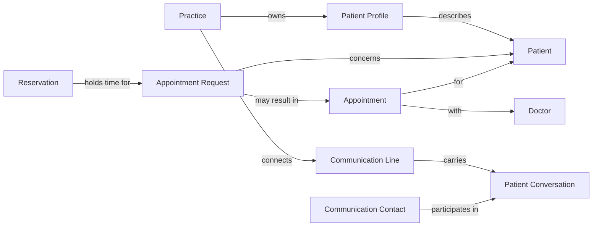

# Medora domain model

This is an evolving, stack-neutral model grounded in the [confirmed product foundation](../.planning/decisions/20261015T085738Z-3/scope-review.md). [GLOSSARY.md](../GLOSSARY.md) holds resolved definitions only. [The active modeling session](../.planning/decisions/20261015T163800Z-5/session.md) holds questions, replies, interpretation and history.

## Established semantic boundaries

- A **Practice** owns its operational records and patient profiles. A person's **Practice Membership** scopes authority in that practice.
- The **Patient** receives care. The **Communication Contact** speaks to the practice and may represent another patient. A practice-connected **Communication Line** is an endpoint, not a person.
- An **Appointment Request** expresses intent; a **Reservation** claims time provisionally; an **Appointment** represents the scheduled consultation. These meanings do not prescribe separate database tables or entity identifiers.
- **Appointment Notification** delivery is distinct from appointment confirmation. A failed message does not silently cancel a confirmed appointment.
- **Patient Profile** and **Intake** preserve the origin of information. An AI summary is not a clinician-verified finding.
- **Staff Conversation** is private by default; **Patient Conversation** involves the contact. **Handoff** changes who actively handles that patient conversation, not who has authority over every practice record.

## Concept relationships already supported by the foundation

The diagram shows meaning, not storage, cardinality or a finalized aggregate design.

## First unresolved relationships

| Scenario | What it tests | Current proposal |
| --- | --- | --- |
| Doctor owns one practice and works at another | Staff identity versus practice membership; multiple roles | One staff identity with independent practice memberships and role combinations |
| Two adults share one WhatsApp number | Contact person versus sender address | A separate contact-address concept; do not infer speaker identity from a number |
| Reservation expires before staff review | Request lifecycle versus temporary hold lifecycle | Keep the underlying request open, explicitly without a reserved slot |

These are proposals, not accepted domain rules. Their exact questions and recommendations are in the active session. The proposed contact-address term **Contact Point** is deliberately not yet added to the glossary.

## Questions intentionally still open

Account and membership cardinalities, shared addresses, request closure, and detailed cross-practice identity relationships require explicit modeling decisions. The accepted practice-scoped record boundary remains in force. Later lifecycle scenarios must address hold/replacement expiry, verification, staff approval, cancellation and rescheduling using the confirmed rules, without choosing storage structures prematurely.

## Relation to existing follow-ups

This session advances the domain-modeling portion of booking-policy and identity/permission work. It does not resolve their numerical settings, verification evidence, fine-grained permissions or complete acceptance matrices. No application code exists to contradict or validate the model; there is only repository tooling and documentation.
